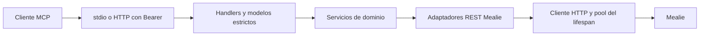

# Arquitectura Python

Un proceso ejecuta un transporte: stdio por defecto o Streamable HTTP en /mcp. Ambos usan create_server y el mismo catálogo de78 herramientas y un prompt. No hay servidor SSE antiguo, tareas MCP en segundo plano, OAuth, persistencia propia ni ejecución de un LLM.

| Módulo | Responsabilidad |
|---|---|
| config.py | Carga explícita, secretos por transporte, TZ, hosts y límites. Sin lecturas de entorno al importar. |
| cli.py y support/stdio.py | Entrada instalada/módulo, logging seguro, proceso stdio y señales. |
| server.py | Factory sin red al construir; un AppState y MealieClient por lifespan. |
| skills.py y skills/mealie/ en la raíz | Proveedor nativo SEP-2640 y fuente única del skill portable; el wheel incluye una copia bajo resources/skills. |
| auth.py, http.py, health.py | Verificador Bearer, app ASGI, límites32MiB y salud mínima. |
| tools/* y models/inputs/* | Catálogo, aliases, presencia de campos, validación y adaptación de errores/resultados MCP. |
| services/* | Matching, resoluciones, batches, colas, snapshots, verificación/restauración y reglas de fecha. |
| mealie/api/* y mealie/client.py | Método/ruta/query/body, JSON, multipart, pool, timeouts y redirects del mismo origen. |
| support/safe_download.py | Transporte público para archivos: DNS fijado, IP pública, TLS/Host/SNI, límites y cierre. |
| resources/* y prompts.py | Metadata curada, instrucciones originales y prompt semanal empaquetados. |

El input público es estricto, con camelCase original, sin coerciones de strings/bools a números. Los mapas declarados abiertos permanecen abiertos. provided_fields distingue omisión de null y valores falsos. Los objetos Mealie conservan campos adicionales donde el contrato original exige read-modify-write. Los resultados existentes siguen como TextContent JSON; no se añaden wrappers structuredContent/outputSchema.

El cliente usa TLS verificado, connect5/read30/write30/pool5 segundos y hasta20 conexiones. La concurrencia se limita por operación, conservando orden del input. La API key saliente solo se envía al origen Mealie configurado; el token HTTP entrante nunca se utiliza como esa credencial. No se reintentan mutaciones automáticamente.

Las escrituras delicadas de ingredientes e instrucciones verifican la respuesta y restauran el snapshot cuando la asociación o el contenido no coincide. Una cancelación después del PATCH permite cleanup acotado; kill forzado y caída del host siguen pudiendo dejar resultado desconocido. El guard expectedUpdatedAt se basa en lectura seguida de PATCH, sin prometer atomicidad que Mealie no ofrece.

El catálogo se serializa con hooks públicos FastMCP y un Transform conserva el orden original. Las diferencias entre protocolos y capacidades del framework están declaradas en [differences.md](migration/differences.md). El ajuste del límite HTTP del SDK está aislado y comprobado durante startup: revisar esa integración al actualizar FastMCP/SDK.

La referencia original es inmutable; el runtime es Python puro. Las [pruebas de compatibilidad](migration/acceptance.md) separan fixtures, procesos reales, imagen instalada y un Mealie desechable. Una prueba con SDK no certifica automáticamente un cliente de escritorio ni un proxy público.
