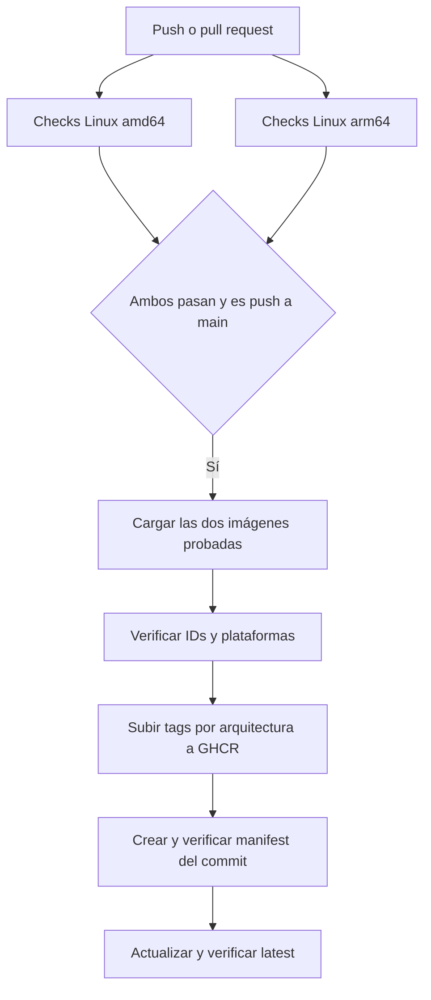

# CI y publicación automática en GHCR

[English README](../README.md) · [Índice](README.md)

El workflow único [ci.yaml](../.github/workflows/ci.yaml) comprueba el código en
cada push y pull request. Un push a `main` publica la imagen únicamente cuando
todas las comprobaciones de ambas arquitecturas terminan correctamente.

## Flujo



Los jobs usan runners nativos `ubuntu-24.04` y `ubuntu-24.04-arm`. Python, tests
y builds se ejecutan dentro del Dev Container Linux. No se introduce un runtime
Node/TypeScript en el producto ni en sus comandos de instalación o pruebas.

Cada plataforma ejecuta:

1. `uv sync --frozen --group dev`, Ruff, formato y mypy.
2. Build del runtime para esa arquitectura desde el mismo commit.
3. La suite completa con cobertura y JUnit, incluyendo la imagen instalada,
   stdio, HTTP, autenticación y skills.
4. Compatibilidad:78 herramientas con casos positivos y negativos, cobertura de
   líneas >=90% y ramas >=85%, y documentación generada vigente.
5. Integración con Mealie desechable: cuatro combinaciones de stdio/HTTP y
   protocolos2026-07-28/2025-11-25. No utiliza una instancia personal.
6. Escaneo del runtime: rechaza secretos y HIGH/CRITICAL con versión corregida
   disponible; conserva informe, SBOM CycloneDX y los avisos restantes.
7. Build de wheel y sdist.

Los fallos bloquean la publicación. Los informes se conservan aunque un job
falle. Ver [E2E](testing/local-e2e.md) y [desarrollo](development.md).

## Publicar las mismas imágenes que se probaron

Cada job correcto de `main` conserva un archivo Docker de su runtime y su image
ID durante un día. `publish` depende de toda la matriz: no se inicia tras el éxito
de una sola plataforma.

El publicador descarga ambos archivos, comprueba IDs y `linux/amd64` /
`linux/arm64`, y sube esas imágenes sin reconstruirlas. Obtiene sus digests del
registry, crea el índice multiarch del commit y comprueba que contiene exactamente
esos dos digests. Solo entonces actualiza `latest` y verifica su digest. El
resumen del job incluye la referencia publicada y el digest final.

Un fallo al subir la segunda arquitectura puede dejar un tag de arquitectura del
commit; no promociona ese resultado incompleto a `latest`. Las imágenes de prueba
no llevan attestations OCI: el SBOM y el informe de escaneo se conservan como
artefactos del workflow, separados de la imagen.

## Destino y etiquetas

```text
ghcr.io/brunofelixns/mealie-mcp-server:latest
ghcr.io/brunofelixns/mealie-mcp-server:sha-<SHA completo del commit>
```

También se crean tags por arquitectura con sufijos `-amd64` y `-arm64`. `latest`
sigue el último push a `main` verificado. Usar el tag del commit o su digest para
fijar un despliegue reproducible. El pipeline no sobrescribe `0.1.0` ni cambia la
versión del paquete en cada push. Un fork utiliza su propio namespace, obtenido
de `GITHUB_REPOSITORY`.

Las PR, incluidas las de forks, y los pushes a otras ramas ejecutan checks sin
permisos de publicación. La concurrencia cancela ejecuciones anteriores de la
misma referencia cuando llega código nuevo.

## Permisos y visibilidad

El permiso global es `contents: read`. Solo `publish` recibe `packages: write`;
se autentica con el `GITHUB_TOKEN` temporal. No requiere PAT, `docker login` local
ni secretos Mealie reales. Las credenciales no se pasan al build.

Si un paquete existente rechaza el push con `permission_denied`, revisar
**Package settings → Manage Actions access** y conceder escritura al repositorio
que ejecuta el workflow. El paquete debe estar asociado al mismo repositorio.

La visibilidad del repositorio y la de GHCR son independientes. Hacer público
el código no cambia automáticamente un paquete existente de privado a público.
Un paquete privado requiere autenticación para descargarlo; uno público permite
descarga anónima. La visibilidad del paquete se administra en GitHub Packages.

## Mantenimiento y recuperación

Los scripts de publicación local y el release manual se retiraron; sus versiones
históricas permanecen en Git. Para publicar código nuevo, hacer push a `main` y
revisar Actions. Si falla, corregir la causa y subir el cambio, o usar
**Re-run failed jobs** cuando el fallo sea transitorio. No se añaden retries de
escrituras a Mealie.

Los archivos de imágenes duran un día para reducir almacenamiento. Si una
repetición del publicador ya no los encuentra, volver a ejecutar todos los jobs
para generar y verificar ambas imágenes. No sustituirlos por un build sin tests.
Las evidencias de verificación se conservan14 días.

Los [resultados históricos de migración](migration/acceptance.md) describen lo
probado en aquella fecha. Un workflow configurado o un build local no demuestran
una ejecución remota: consultar el run y el digest GHCR del commit concreto.

Referencias: [publicación con Actions](https://docs.github.com/en/actions/tutorials/publish-packages/publish-docker-images),
[GITHUB_TOKEN y GHCR](https://docs.github.com/en/packages/working-with-a-github-packages-registry/working-with-the-container-registry),
[permisos y visibilidad](https://docs.github.com/en/packages/learn-github-packages/configuring-a-packages-access-control-and-visibility).
