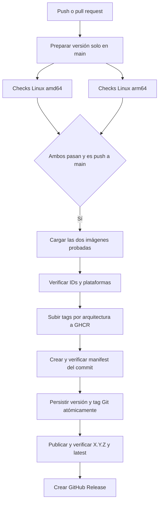

# CI y publicación automática en GHCR

[English README](../README.md) · [Índice](README.md)

El workflow único [ci.yaml](../.github/workflows/ci.yaml) comprueba el código en
cada push y pull request. Un push a `main` publica la imagen únicamente cuando
todas las comprobaciones de ambas arquitecturas terminan correctamente.

## Flujo



Los jobs usan runners nativos `ubuntu-24.04` y `ubuntu-24.04-arm`. Python, tests
y builds se ejecutan dentro del Dev Container Linux. No se introduce un runtime
Node/TypeScript en el producto ni en sus comandos de instalación o pruebas.
La inspección de imágenes comprueba `Os` y `Architecture` explícitamente y no
requiere `image inspect --platform`, que solo existe desde Docker API1.49.

Cada plataforma ejecuta:

1. `uv sync --frozen --group dev`, Ruff, formato y mypy.
2. Build del runtime para esa arquitectura desde el mismo commit.
3. La suite completa con cobertura y JUnit, incluyendo la imagen instalada,
   stdio, HTTP, autenticación y skills.
4. Compatibilidad:78 herramientas con casos positivos y negativos, cobertura de
   líneas >=90% y ramas >=85%, y documentación generada vigente.
5. Integración con Mealie desechable: cuatro combinaciones de stdio/HTTP y
   protocolos2026-07-28/2025-11-25. No utiliza una instancia personal.
6. Escaneo del runtime: rechaza secretos y HIGH/CRITICAL con versión corregida
   disponible; conserva informe, SBOM CycloneDX y los avisos restantes.
7. Build de wheel y sdist.

Los fallos bloquean la publicación. Los informes se conservan aunque un job
falle. Ver [E2E](testing/local-e2e.md) y [desarrollo](development.md).

## Versión automática

Cada push a `main` calcula una única versión para todo el lote de commits nuevos:

| Commits del lote | Incremento | Ejemplo desde 0.2.3 |
|---|---|---|
| Header con `!` o footer `BREAKING CHANGE:` / `BREAKING-CHANGE:` | Major | 1.0.0 |
| `feat` o `fix`, con scope opcional | Minor | 0.3.0 |
| Resto: `docs`, `test`, `ops`, `chore`, etc. | Patch | 0.2.4 |

Prevalece la regla de mayor impacto. La subida minor para `fix` es la convención
de este proyecto. Las PR y pushes a otras ramas no incrementan la versión.

`pyproject.toml` es la fuente de versión. `scripts/ci_version.py` sincroniza el
paquete propio en `uv.lock`, la etiqueta OCI del Dockerfile y los catálogos README
en ambos idiomas. No cambia dependencias, el catálogo MCP ni sus baselines.
`.release.json` delimita los commits pendientes: inicialmente apunta al último
runtime Python publicado antes de activar esta automatización. Los tags upstream
heredados no se usan para calcular la versión Python.

El job `prepare`, sin permisos de escritura, crea un commit **local**, reproducible
por su contenido y la fecha del commit fuente, y un Git bundle. Ambos runners
restauran ese mismo commit, incluso con checkout superficial. Así las pruebas
ejercitan la versión que llegará al wheel, CLI, MCP y contenedor. El bundle y las
notas se conservan un día junto a los archivos de imagen.

Después de pasar todos los checks, `publish` comprueba que `main` no ha avanzado,
sube el manifest del commit probado y envía el commit de versión y `vX.Y.Z` mediante
un push Git atómico, sin force. A continuación verifica `X.Y.Z` y `latest`, y crea
la GitHub Release con las notas del lote. Los tags existentes con otro contenido
provocan error; no se sobrescriben. Si los tests fallan, la versión no se persiste.

El commit automático usa `chore(release): X.Y.Z [skip ci]` y el `GITHUB_TOKEN`
temporal. Los pushes realizados con ese token no disparan otra ejecución de CI;
los tags tampoco son triggers de este workflow. Tras una publicación, actualizar
el checkout local con `git pull --ff-only` antes de enviar más cambios.

## Publicar las mismas imágenes que se probaron

Cada job correcto de `main` conserva un archivo Docker de su runtime y su image
ID durante un día. `publish` depende de toda la matriz: no se inicia tras el éxito
de una sola plataforma.

El publicador descarga ambos archivos, comprueba IDs y `linux/amd64` /
`linux/arm64`, y sube esas imágenes sin reconstruirlas. Obtiene sus digests del
registry, crea el índice multiarch del commit y comprueba que contiene exactamente
esos dos digests. Solo entonces persiste Git, publica la versión y actualiza
`latest`, verificando ambos digests. El
resumen del job incluye la referencia publicada y el digest final.

Un fallo al subir la segunda arquitectura puede dejar un tag de arquitectura del
commit; no promociona ese resultado incompleto a `latest`. Las imágenes de prueba
no llevan attestations OCI: el SBOM y el informe de escaneo se conservan como
artefactos del workflow, separados de la imagen.

## Destino y etiquetas

```text
ghcr.io/brunofelixns/mealie-mcp-server:latest
ghcr.io/brunofelixns/mealie-mcp-server:X.Y.Z
ghcr.io/brunofelixns/mealie-mcp-server:sha-<SHA completo del commit>
```

También se crean tags por arquitectura con sufijos `-amd64` y `-arm64`. `latest`
sigue el último push a `main` verificado. Usar el tag del commit o su digest para
fijar un despliegue reproducible. El SHA identifica el commit automático de versión,
hijo del push original y probado por ambos runners. `vX.Y.Z` es el tag Git y la
GitHub Release. El pipeline no sobrescribe la imagen histórica `0.1.0`.
Un fork utiliza su propio namespace, obtenido
de `GITHUB_REPOSITORY`.

Las PR, incluidas las de forks, y los pushes a otras ramas ejecutan checks sin
permisos de publicación. La concurrencia cancela ejecuciones anteriores de la
misma referencia cuando llega código nuevo.

## Permisos y visibilidad

El permiso global es `contents: read`. Solo `publish` recibe `contents: write`
y `packages: write` para el commit/tag/Release y GHCR;
se autentica con el `GITHUB_TOKEN` temporal. No requiere PAT, `docker login` local
ni secretos Mealie reales. Las credenciales no se pasan al build.

Si un paquete existente rechaza el push con `permission_denied`, revisar
**Package settings → Manage Actions access** y conceder escritura al repositorio
que ejecuta el workflow. El paquete debe estar asociado al mismo repositorio.

La visibilidad del repositorio y la de GHCR son independientes. Hacer público
el código no cambia automáticamente un paquete existente de privado a público.
Un paquete privado requiere autenticación para descargarlo; uno público permite
descarga anónima. La visibilidad del paquete se administra en GitHub Packages.

## Mantenimiento y recuperación

Los scripts de publicación local y el release manual se retiraron; sus versiones
históricas permanecen en Git. Para publicar código nuevo, hacer push a `main` y
revisar Actions. Si falla, corregir la causa y subir el cambio, o usar
**Re-run failed jobs** cuando el fallo sea transitorio. No se añaden retries de
escrituras a Mealie.

**Re-run failed jobs** reutiliza el bundle y las imágenes: conserva la misma versión
y el mismo commit y acepta un push Git ya completado. Git y GHCR no comparten una
transacción: un fallo tras persistir Git puede dejar un tag sin imagen o Release;
repetir el job completa la publicación. Si `main` avanzó entretanto, la repetición
se detiene para no promocionar una versión anterior sobre la nueva.

Los archivos de imágenes y versión duran un día para reducir almacenamiento. Si
expiran antes de persistir Git, repetir todos los jobs. Si ya existe el tag pero
faltan artefactos, enviar un nuevo commit a `main` para generar la siguiente versión
y revisar el fallo anterior. No sobrescribir versiones ni sustituir las imágenes
probadas por un build sin tests.
Las evidencias de verificación se conservan14 días.

Los [resultados históricos de migración](migration/acceptance.md) describen lo
probado en aquella fecha. Un workflow configurado o un build local no demuestran
una ejecución remota: consultar el run y el digest GHCR del commit concreto.

Referencias: [publicación con Actions](https://docs.github.com/en/actions/tutorials/publish-packages/publish-docker-images),
[GITHUB_TOKEN y GHCR](https://docs.github.com/en/packages/working-with-a-github-packages-registry/working-with-the-container-registry),
[eventos generados por GITHUB_TOKEN](https://docs.github.com/en/actions/how-tos/write-workflows/choose-when-workflows-run/trigger-a-workflow),
[permisos y visibilidad](https://docs.github.com/en/packages/learn-github-packages/configuring-a-packages-access-control-and-visibility).
