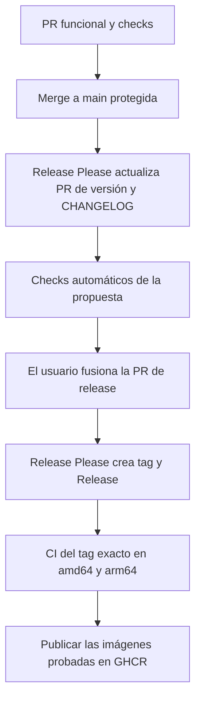

# Main protegida, Release Please oficial y GHCR

[English README](../README.md) · [Índice](README.md)

El código funcional entra en `main` mediante PR. **Release Please oficial** mantiene
otra PR con la versión siguiente y el [CHANGELOG](../CHANGELOG.md) acumulado.
Fusionar esa propuesta decide cuándo sale la versión. No se publica en cada merge
funcional ni se escriben commits de versión directamente en main.

La detección de la propuesta consulta la API REST directamente, con espera acotada
para propagación de metadatos. No depende de la indexación de búsqueda por labels.
Si no aparece una PR propia pendiente, el workflow falla visiblemente. Su resumen
enlaza la propuesta e indica cómo iniciar sus checks. Las PR de forks no se seleccionan.

## Flujo

1. Crear una rama y una PR hacia `main`, con título Conventional Commit. Preferir
   squash para que el título y los breaking footers de la PR describan el merge.
2. Pasar `Verify amd64` y `Verify arm64`, con la rama actualizada. Main exige PR
   incluso para administradores, historial lineal y conversaciones resueltas;
   no admite force pushes ni borrado.
3. El workflow [release-please.yaml](../.github/workflows/release-please.yaml) utiliza
   Release Please para crear o actualizar una sola PR, con los cambios pendientes.
   La propuesta **queda abierta**. Una GitHub App dedicada inicia sus checks
   automáticamente; esperar a ambos checks antes de fusionarla.
4. Cuando el usuario fusiona esa PR, la acción oficial crea el tag y la GitHub
   Release. El workflow despacha [ci.yaml](../.github/workflows/ci.yaml) sobre ese
   tag exacto, incluyendo el parámetro `release_tag`.
5. CI prueba y construye ese commit en amd64 y arm64 nativos. Solo después publica
   las imágenes probadas, sin reconstrucción, como `X.Y.Z`, `sha-<commit>` y `latest`.



La Release puede aparecer antes de que termine su imagen; revisar la ejecución de
CI antes de desplegarla. Un dispatch sin `release_tag` solo ejecuta checks.

## Versiones y archivos

| Commits pendientes | Incremento | Ejemplo desde 0.2.3 |
|---|---|---|
| Header con `!` o footer `BREAKING CHANGE:` / `BREAKING-CHANGE:` | Major | 1.0.0 |
| `feat` o `fix`, con scope opcional | Minor | 0.3.0 |
| `docs`, `test`, `ops`, `chore`, `build`, etc. | Patch | 0.2.4 |

Prevalece el mayor incremento. Subir minor para `fix` es la convención de este
repositorio, que difiere del default de Release Please. El pequeño helper Python
[release_policy.py](../scripts/release_policy.py), ejecutado en Dev Container,
calcula únicamente el argumento oficial `--release-as`. No cambia archivos, crea
commits ni publica. La creación y actualización de PRs, versiones, CHANGELOG,
tags y Releases corresponde íntegramente a Release Please.

La configuración es [release-please-config.json](../release-please-config.json),
con estado en [.release-please-manifest.json](../.release-please-manifest.json).
El bootstrap parte del último runtime Python publicado antes de esta automatización;
los tags upstream antiguos no determinan la versión Python. La historia first-parent
del manifest delimita cada lote posterior e incluye correctamente merges squash.

Release Please actualiza pyproject, su manifest, CHANGELOG, la versión del paquete
propio de `uv.lock`, la etiqueta OCI y ambos catálogos README. Los comentarios
`x-release-please-*` delimitan las versiones genéricas. El selector TOML del lock
usa `.name.value` porque el actualizador oficial 17.11.2 conserva valores etiquetados
para cambiar solo el campo elegido, manteniendo el formato y las dependencias.
`uv lock --check --offline` comprueba la coherencia del resultado.

Usar los tipos Conventional Commit configurados: feat, fix, refactor, perf, style,
test, docs, build, ops, chore, ci y revert. Release Please puede omitir una propuesta
si solo hay mensajes no convencionales o tipos ajenos a esa lista, aunque se
calcule una subida patch. No editar versiones ni el manifest manualmente.

## Herramientas y permisos

Se usan la acción oficial `googleapis/release-please-action` v5.0.0, fijada por SHA,
y su CLI oficial `release-please@17.11.2`. El CLI aplica `--release-as` con manifest;
la acción crea las Releases de PRs ya fusionadas. El usuario autorizó Node24 solo
para estas herramientas de CI; la excepción está en [AGENTS.md](../AGENTS.md).
Producto, instalación, Dev Container, tests y builds continúan siendo Python.

Release Please se serializa por repositorio y recibe escritura de contenido,
issues/PRs y Actions para gestionar sus ramas, labels, tags, Releases y el dispatch del tag.
Main no concede bypass al bot. El publicador GHCR solo recibe `contents: read` y
`packages: write`: no puede escribir commits, tags ni Releases en GitHub.

La creación y actualización de la propuesta usa un **token de instalación de una
GitHub App privada**, instalada únicamente en este repositorio. La acción oficial
`actions/create-github-app-token` v3.3.0, fijada por SHA, lo genera solo cuando hay
una versión pendiente. Solicita explícitamente un repositorio y dos permisos:

| Permiso de la App | Uso |
|---|---|
| Contents: read and write | Crear y actualizar la rama y los archivos de versión |
| Pull Requests: read and write | Mantener la propuesta y sus etiquetas |
| Metadata: read-only | Permiso obligatorio de GitHub |

No requiere Issues write: la API de etiquetas admite Pull Requests write. La App
no recibe permisos de Actions, Workflows, Packages ni Administration, ni bypass de
main. El workflow comprueba que el token enumere exactamente el repositorio actual
antes de pasarlo al CLI. Si faltan credenciales o el ámbito no coincide, falla; no
hay fallback a GITHUB_TOKEN. El token solo llega a esa comprobación y al CLI y se
revoca al terminar el job. No se usa un PAT personal ni credenciales Mealie.

GitHub pone en espera de aprobación los workflows de PR creados o actualizados con
GITHUB_TOKEN. La App evita ese clic porque la actualización usa otra identidad;
no aprueba ni fusiona PRs. Las Releases ya fusionadas y su dispatch siguen usando
GITHUB_TOKEN. Los permisos por defecto del repositorio permanecen en lectura.

### Configurar o rotar la App

1. En **Settings → Developer settings → GitHub Apps**, registrar una App privada
   para la cuenta propietaria, sin webhook ni OAuth de usuario. Usar el repositorio
   como Homepage URL y los permisos de la tabla anterior.
2. Instalarla con **Only select repositories**, eligiendo únicamente
   `brunofelixns/mealie-mcp-server` (o el repositorio del fork).
3. En **Repository settings → Secrets and variables → Actions**, guardar el
   **Client ID** público en la variable `RELEASE_PLEASE_APP_CLIENT_ID` y una clave
   privada de la App en el secreto `RELEASE_PLEASE_APP_PRIVATE_KEY`. Generar y
   transferir la clave directamente al secreto; no incluirla en Git, logs,
   artefactos, imágenes ni archivos de configuración de clientes MCP.
4. Ejecutar Release Please y verificar que el siguiente evento `pull_request`
   arranque sin aprobación manual. El resumen de Actions enlaza la propuesta.

Para rotar, generar otra clave, actualizar el mismo secreto y comprobar una
ejecución correcta antes de revocar la clave antigua en GitHub. Para desactivar la
integración, desinstalar la App del repositorio y retirar su secreto/variable.
Si falla la creación del token, revisar Client ID, clave, instalación, repositorio
seleccionado y permisos; no ampliar el ámbito ni reemplazarlo por el token personal
del CLI. El entorno local de desarrollo no necesita la clave.

Un dispatch explícito activa la publicación del tag creado con el token temporal.
Exige versión semántica, coincidencia de ambas imágenes, revisión Git, tag y una
Release existente que no sea draft. Un dispatch sin `release_tag` solo ejecuta pruebas.

La configuración aplicada a main está en [main-protection.json](main-protection.json).
Exige ambos checks de GitHub Actions, sin aprobaciones de otra persona para permitir
mantenimiento individual. La PR y sus checks siguen siendo obligatorios.

## Checks, tags y recuperación

Cada rama/PR y dispatch se verifica en `ubuntu-24.04` y `ubuntu-24.04-arm`, dentro
del Dev Container: frozen sync y lock check, Ruff, formato, mypy, suite completa con
cobertura/JUnit, compatibilidad 78/78 con líneas >=90% y ramas >=85%, documentación
vigente, Mealie real desechable, escaneo de imagen y wheel/sdist. El escaneo bloquea
secretos y HIGH/CRITICAL corregibles; los avisos restantes y el SBOM se conservan.
Ver [desarrollo](development.md) y [E2E](testing/local-e2e.md).

Los informes duran 14 días y las imágenes probadas un día. El publicador verifica
image IDs, plataformas, versión, revisión y los dos digests del índice. No reconstruye
ni incorpora attestations OCI; el SBOM es un artefacto separado. Las publicaciones
se serializan con `queue: max` para conservar hasta 100 publicaciones pendientes.
La promoción consulta el manifest Python de main, no los tags upstream heredados;
repetir una versión antigua no reduce `latest`.

```text
ghcr.io/brunofelixns/mealie-mcp-server:X.Y.Z
ghcr.io/brunofelixns/mealie-mcp-server:latest
ghcr.io/brunofelixns/mealie-mcp-server:sha-<commit del tag>
```

También existen tags por arquitectura `-amd64` / `-arm64`. No se sobrescribe el
tag histórico `0.1.0` ni una versión existente con otro digest. Código e imagen
son públicos; un fork debe configurar sus permisos, protección y paquete propios.

Si falla un check o una subida, usar **Re-run failed jobs** mientras se conserven
las imágenes exactas. GitHub y GHCR no comparten una transacción; una Release puede
quedar pendiente de imagen. Si Release Please creó la Release pero falló su dispatch,
repetir Release Please no vuelve a emitir `release_created`; despachar CI para el tag:

```bash
gh workflow run ci.yaml --repo brunofelixns/mealie-mcp-server --ref vX.Y.Z -f release_tag=vX.Y.Z
```

Esto ordena una ejecución remota, sin publicar desde el equipo local. Si los archivos
de imagen expiraron y ya existe una publicación parcial, revisar el estado y preparar
la siguiente versión; no sobrescribirla con un build distinto sin tests. Ante rechazo
de GHCR revisar **Package settings → Manage Actions access**.

Referencias: [Release Please oficial](https://github.com/googleapis/release-please),
[acción oficial](https://github.com/googleapis/release-please-action),
[protección de ramas](https://docs.github.com/en/rest/branches/branch-protection),
[eventos y GITHUB_TOKEN](https://docs.github.com/en/actions/how-tos/write-workflows/choose-when-workflows-run/trigger-a-workflow),
[token oficial de App](https://github.com/actions/create-github-app-token),
[permisos de etiquetas](https://docs.github.com/en/rest/issues/labels#create-a-label).
