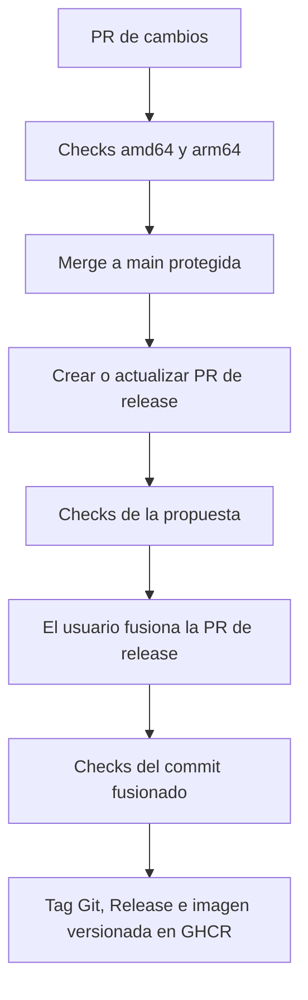

# CI, main protegida y PR de release

[English README](../README.md) · [Índice](README.md)

El workflow [ci.yaml](../.github/workflows/ci.yaml) utiliza una PR de release
acumulativa. El usuario decide cuándo fusionarla; el incremento de versión y
la publicación posterior son automáticos. No hay publicación desde local.

## Flujo de trabajo

1. Crear una rama y una PR hacia `main`. Usar un título Conventional Commit y
   fusionar mediante squash para conservar el significado del cambio.
2. Los checks `Verify amd64` y `Verify arm64` deben pasar, con la rama actualizada.
   `main` requiere PR incluso para administradores; no permite force push ni borrado.
3. Tras fusionar cambios normales, el CI crea o actualiza una única PR desde
   `codex/release-main`, con la próxima versión y las notas de todos los cambios
   pendientes. Los cambios siguientes se acumulan en esa misma propuesta.
4. La PR de release ejecuta los mismos checks y **queda abierta**. Fusionarla cuando
   se quiera publicar, una vez pasadas sus comprobaciones obligatorias.
5. El CI comprueba el commit realmente fusionado en ambas arquitecturas. Solo
   entonces publica su tag Git, GitHub Release y la imagen multiarch en GHCR.



Los merges normales no publican nuevas versiones ni actualizan `latest`. La
identificación de una release exige una PR fusionada cuyo `merge_commit_sha`
coincida con el push, base `main`, rama `codex/release-main` y repositorio propio.
Una PR de un fork con el mismo nombre de rama no autoriza publicación.

## Cálculo de la versión

| Commits pendientes | Incremento | Ejemplo desde 0.2.3 |
|---|---|---|
| Header con `!` o footer `BREAKING CHANGE:` / `BREAKING-CHANGE:` | Major | 1.0.0 |
| `feat` o `fix`, con scope opcional | Minor | 0.3.0 |
| Resto: `docs`, `test`, `ops`, `chore`, etc. | Patch | 0.2.4 |

Prevalece el cambio de mayor impacto. Subir minor para `fix` es la convención de
este proyecto. `pyproject.toml` es la versión canónica; el preparador Python
[ci_version.py](../scripts/ci_version.py) sincroniza el paquete propio de `uv.lock`,
la etiqueta OCI del Dockerfile y ambos catálogos README. No cambia dependencias,
el contrato MCP ni las capturas inmutables.

`.release.json` comienza en el último runtime Python publicado antes de esta
automatización. Después identifica la última PR de release mediante el cambio
de ese archivo en la historia first-parent, incluyendo merges squash. Así el merge
de una release no provoca otra subida patch. Los antiguos tags upstream no
determinan la versión Python. No editar estos números manualmente.

El commit propuesto es reproducible y se genera en el Dev Container, sin pushes
desde el script Python. No incluye `[skip ci]`: esa anotación impediría ejecutar
la publicación después de un squash o rebase. El workflow solo actualiza la rama
reservada de release mediante `--force-with-lease`; nunca escribe commits en main.
Las actualizaciones de propuestas se serializan y una ejecución obsoleta no puede
reemplazar la propuesta de un main más reciente.

## Checks y ejecución

Cada push de rama y PR ejecuta runners nativos `ubuntu-24.04` y
`ubuntu-24.04-arm`. Python, tests y builds se ejecutan en el Dev Container Linux:

1. Instalación frozen, Ruff, formato y mypy.
2. Build del runtime nativo con la revisión Git del checkout.
3. Suite completa con cobertura y JUnit, incluidos contenedor, stdio, HTTP y skills.
4. Compatibilidad: 78 herramientas con casos positivos y negativos, líneas >=90%,
   ramas >=85%, y documentación generada vigente.
5. Mealie real desechable: stdio/HTTP y protocolos 2026-07-28/2025-11-25.
6. Escaneo: cero secretos y cero HIGH/CRITICAL con corrección disponible. Los avisos
   sin versión corregida y el SBOM CycloneDX quedan registrados como artefactos.
7. Wheel y sdist, imagen probada, image ID, versión y revisión realmente medidas.

Los informes se conservan 14 días aunque fallen tests. Las imágenes probadas
duran un día. El publicador comprueba IDs, plataformas, versión y revisión de
ambas imágenes y las sube sin reconstruirlas. Verifica que el índice multiarch
contenga exactamente los dos digests probados. No añade attestations OCI: el SBOM
y escaneo se distribuyen como artefactos separados. Ver [E2E](testing/local-e2e.md)
y [desarrollo](development.md).

## Protección de main y permisos

La configuración reproducible está en [main-protection.json](main-protection.json).
Exige los checks nativos de GitHub Actions, rama al día, PR e historial lineal,
resolución de conversaciones y aplicación a administradores. No se exige una
segunda persona que apruebe porque el repositorio puede tener un solo mantenedor;
sí se exige PR. No se concede bypass al bot.

Los permisos globales son `contents: read` y `pull-requests: read`. Solo el job de
propuesta recibe escritura de contenido/PR y `actions: write`, para actualizar
su rama, mantener la PR y despachar sus checks. Solo `publish` recibe
`packages: write` y escritura de contenido para el tag y la Release. No hace
push a main. No requiere PAT permanente, credenciales Mealie reales ni Node.

El ajuste del repositorio **Allow GitHub Actions to create and approve pull
requests** debe estar activado para permitir crear PRs con `GITHUB_TOKEN`.
GitHub agrupa ambas capacidades en ese ajuste; este workflow no aprueba PRs ni
las fusiona. Se conserva el permiso por defecto de los workflows en lectura.

El workflow usa `workflow_dispatch` explícito para comprobar cada actualización
de la PR automática. Esto evita depender del comportamiento especial de eventos
creados con `GITHUB_TOKEN`, incluidos posibles flujos en espera de aprobación.
El dispatch solo ejecuta checks: no crea otra propuesta ni publica imágenes.

## Tags y recuperación

```text
ghcr.io/brunofelixns/mealie-mcp-server:X.Y.Z
ghcr.io/brunofelixns/mealie-mcp-server:latest
ghcr.io/brunofelixns/mealie-mcp-server:sha-<commit fusionado>
```

Se crean tags de arquitectura con sufijos `-amd64` / `-arm64`, el tag Git `vX.Y.Z`
y una GitHub Release con las notas de la PR. `X.Y.Z` es la referencia estable para
desplegar. El tag histórico `0.1.0` se conserva. Las publicaciones se serializan;
repetir una versión anterior no devuelve `latest` a una versión inferior.

Los fallos bloquean la publicación. Git y GHCR no ofrecen una transacción común:
un fallo parcial puede dejar un tag sin completar imágenes o Release. Usar
**Re-run failed jobs** mientras existan los artefactos: reutiliza las mismas
imágenes y versión. Los tags existentes con otro contenido provocan error.
Si los archivos expiraron, revisar la publicación y preparar la siguiente release;
no sobrescribir versiones ni reconstruir una imagen sin comprobarla.

La visibilidad del código y GHCR se gestiona por separado; ambos se publicaron
como públicos. Un fork debe configurar sus permisos, protección y paquete propios.
Ante `permission_denied`, revisar **Package settings → Manage Actions access**.

Referencias: [Release Please y PRs acumulativas](https://github.com/googleapis/release-please),
[protección de ramas](https://docs.github.com/en/rest/branches/branch-protection),
[eventos y GITHUB_TOKEN](https://docs.github.com/en/actions/how-tos/write-workflows/choose-when-workflows-run/trigger-a-workflow),
[GHCR con Actions](https://docs.github.com/en/actions/tutorials/publish-packages/publish-docker-images).
